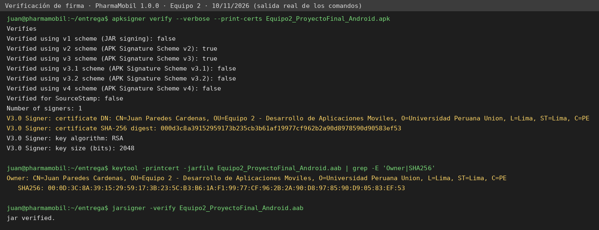

# Sesión 14 · Mejoras finales, firma y builds AAB e IPA

Juan Paredes Cárdenas · código 202311735 · grupo 2 (Equipo 2).
Desarrollo de Aplicaciones Móviles, ciclo VI, semestre 2026-2. Fecha de la sesión: 10 de noviembre de 2026.
Rama `feature/builds-14`, creada desde `develop` después de fusionar `feature/integrador-13` (commit `f3e836f`).
Cada paso de la guía tiene su propio commit.

## Paso 1. Ficha de integración cerrada y alcance congelado

Se revisó la tabla de huecos de la sesión 13 ([docs/sesion13-integrador.md](sesion13-integrador.md)) y se
recorrió el código antes de firmar. Cada fila queda en una sola columna.

| # | Hueco (sesión 13) | Severidad | Decisión final | Qué se hizo / motivo |
|---|---|---|---|---|
| 1 | Fila rechazada (409/400) bloqueaba la cola | Alta | **Cerrado** (S13) | Columnas `intentos` y `ultimoError`; fallos permanentes marcados. |
| 2 | 500/503 tratado igual que 409 | Alta | **Cerrado** (S13) | `ResultadoEnvio` Exito / Transitorio / Permanente. |
| 3 | Reintentos sin límite | Media | **Cerrado** (S13) | 5 intentos con espera 1, 2, 4, 8 y 16 s. |
| 4 | Pantalla solo con «N pendientes» | Alta | **Cerrado** (S13) | Barra de estado con red, fallidas y antigüedad. |
| 5 | Fila fallida sin aviso en segundo plano | Media | **Cerrado** (S13) | Notificación local con permiso de tres estados. |
| 6 | Sin telemetría | Media | **Cerrado** (S13) | Crashlytics detrás de `Telemetria` (activa con `google-services.json` propio). |
| 7 | Al cerrar sesión la base local conserva los datos del usuario anterior | Alta | **Se cierra hoy** → cerrado | `ProductoLocal.limpiar()` borra inventario, cola y fecha de sincronización; `AuthRepositorioRest` lo invoca en `cerrarSesion()`. Prueba `CierreSesionLimpiezaTest`. Rompía el paso 8 del recorrido («equipo limpio para otro usuario»). |
| 7b | Aviso antes de cerrar sesión si quedan pendientes | Media | **Se declara** (L-1) | Requiere un diálogo nuevo en la interfaz (rediseño de pantalla, prohibido tras congelar). Para cerrarla: diálogo de confirmación que muestre `contarPendientes()` y ofrezca «Sincronizar y salir». |
| 8 | Token vencido a mitad de formulario pierde lo escrito | Media | **Se declara** (L-2) | Funcionalidad nueva (borradores persistentes). Para cerrarla: guardar el estado del formulario en `SavedStateHandle`/base local antes de redirigir al login. |
| 9 | Reintento de POST puede duplicar si se pierde la respuesta | Alta | **Se declara** (L-3) | Necesita cambio en PharmaSoft (cabecera `Idempotency-Key`), fuera del alcance del cliente. Mitigado: el 409 por nombre duplicado queda como fallo permanente visible. |
| 10 | 500 en `registrar` relanzaba la excepción | Baja | **Cerrado** (S13) | El producto queda pendiente y se trata como transitorio. |
| 11 | Permisos y telemetría en iOS | Media | **Se declara** (L-4) | `GestorPermisosIos` es stub y `TelemetriaNula` se usa en iOS. Para cerrarla: implementar `UNUserNotificationCenter` y GitLive en `iosMain` con `GoogleService-Info.plist`. |
| 12 | Permiso de cámara para escanear códigos | Baja | **Se descarta** | Nunca estuvo en el alcance comprometido: no existe pantalla de escaneo. Trabajo futuro. |
| 13 | URL del servicio fija en `10.0.2.2` (solo emulador) | Alta | **Se cierra hoy** → cerrado | Hallado hoy. La URL llega del manifiesto (`meta-data pharma.api.url`), que la toma de `-PpharmaApiUrl` o de la variable `PHARMA_API_URL`. Sin valor se usa `10.0.2.2` (emulador). |
| 14 | `usesCleartextTraffic="true"` global, sin configuración de seguridad de red | Media | **Se cierra hoy** → cerrado | Hallado hoy. `res/xml/network_security_config.xml` declara el HTTP de PharmaSoft en la red local. |
| 15 | `versionName = "1.0"` y `applicationId` distinto del pedido para la entrega | Baja | **Se cierra hoy** → cerrado en el paso 3 | `versionName 1.0.0`, `versionCode 1`, `applicationId pe.upeu.pharmamobil`. |

### Alcance congelado (10 de noviembre de 2026)

A partir de este commit no entra funcionalidad nueva: ni funciones fuera del alcance, ni cambios de
arquitectura o de librerías, ni rediseños de pantalla, ni migraciones del esquema. Las dos consultas
nuevas de `Producto.sq` (`borrarTodo`, `borrarMeta`) no cambian el esquema ni requieren migración.
El producto que se entrega es: inicio de sesión JWT con roles, CRUD de productos contra PharmaSoft,
inventario offline-first con cola de envío y sincronización, permiso de notificaciones con tres estados,
cierre de sesión que limpia el equipo y telemetría opcional con Firebase.

## Paso 2. Almacén de claves del equipo

Se creó **un solo** almacén para el Equipo 2, fuera de la carpeta del repositorio, con el comando de la guía
(también en [scripts/crear-almacen-equipo2.sh](../scripts/crear-almacen-equipo2.sh), que se niega a crear el
archivo dentro del repositorio):

```bash
keytool -genkeypair -v \
   -keystore equipo2.jks -storetype JKS \
   -keyalg RSA -keysize 2048 -validity 10000 \
   -alias equipo2
```

| Dato | Valor |
|---|---|
| Archivo | `equipo2.jks` (JKS, fuera del repositorio) |
| Alias | `equipo2` |
| Algoritmo | RSA 2048 bits |
| Titular | `CN=Juan Paredes Cardenas, OU=Equipo 2 - Desarrollo de Aplicaciones Moviles, O=Universidad Peruana Union, L=Lima, ST=Lima, C=PE` |
| Vigencia | 10 000 días: del 10/11/2026 al 28/03/2054 |
| Huella SHA-256 | `00:0D:3C:8A:39:15:29:59:17:3B:23:5C:B3:B6:1A:F1:99:77:CF:96:2B:2A:90:D8:97:85:90:D9:05:83:EF:53` |
| Huella SHA-1 | `85:41:DA:35:99:82:CA:DB:5A:BD:4F:67:8C:03:09:E0:36:0E:CE:9D` |
| Contraseñas | Generadas al azar (24 caracteres). **No se transcriben en ningún archivo del repositorio.** |

**Custodia.** El responsable de la entrega (Juan Paredes) conserva el original. Hay una copia fuera del equipo
de un solo integrante: el archivo y sus contraseñas están guardados en la nube personal del responsable, en una
carpeta privada, y como *Secrets* cifrados del repositorio en GitHub (`KEYSTORE_BASE64`, `KEYSTORE_PASSWORD`,
`KEY_ALIAS`, `KEY_PASSWORD`), que GitHub nunca vuelve a mostrar. Si el almacén se pierde no hay recuperación:
habría que publicar la aplicación con otro identificador.

## Paso 3. Firma configurada sin exponer secretos

1. **`.gitignore`** contiene, antes de cualquier commit con credenciales, las tres líneas de la guía:
   `keystore.properties`, `*.jks` y `*.keystore`. Comprobado con `git check-ignore -v`:
   ```
   .gitignore:26:keystore.properties	keystore.properties
   .gitignore:27:*.jks	x.jks
   .gitignore:28:*.keystore	y.keystore
   ```
2. **`keystore.properties`** (raíz del proyecto, nunca en Git) tiene cuatro claves: `storeFile`, `storePassword`,
   `keyAlias`, `keyPassword`. En el repositorio solo está la plantilla
   [keystore.properties.example](../keystore.properties.example), con asteriscos.
3. **`androidApp/build.gradle.kts`** lee el archivo con `if (f.exists())` y crea `signingConfigs.release` solo si
   hay `storeFile`. Así:
   - quien clona sin el archivo abre y compila el proyecto (`assembleDebug` funciona; la entrega sale sin firmar);
   - con el archivo, `bundleRelease` y `assembleRelease` firman con la clave del equipo.

   Se agregó una guarda respecto del código de la guía: `file(firma.getProperty("storeFile"))` lanza una
   excepción si la propiedad no existe, y el proyecto no abriría para quien no tiene el archivo. La guarda
   `hayFirma` evita ese fallo (criterio 4 de la lista de cotejo).
4. `defaultConfig`: `applicationId = "pe.upeu.pharmamobil"`, `versionCode = 1`, `versionName = "1.0.0"`.
   `buildTypes.release`: firma del equipo, `isMinifyEnabled = true` y `proguard-android-optimize.txt` +
   `proguard-rules.pro`. El `namespace` del código sigue siendo `pe.edu.upeu.pharmamobil` (no cambia paquetes).
5. **En GitHub Actions** el workflow escribe `keystore.properties` en tiempo de ejecución desde los *Secrets*
   del repositorio y lo borra al terminar; el registro de Actions enmascara los valores.

## Paso 4. Paquete de aplicación y instalable firmados, firma verificada

**Cómo se generan.** El workflow [`.github/workflows/sesion14-builds.yml`](../.github/workflows/sesion14-builds.yml)
ejecuta en GitHub Actions (Ubuntu, JDK 21, AGP 9.0.1, build-tools 37.0.0) las dos tareas de la guía:

```bash
./gradlew :androidApp:bundleRelease  -PpharmaApiUrl=http://10.40.28.47:8080/api/v1/   # → .aab (entregable E3)
./gradlew :androidApp:assembleRelease -PpharmaApiUrl=http://10.40.28.47:8080/api/v1/   # → .apk (pruebas)
```

`10.40.28.47` es la IPv4 del Wi-Fi de la PC donde corre PharmaSoft (`ipconfig`), tomada de
[ci/sesion14/pharma-api-url.txt](../ci/sesion14/pharma-api-url.txt).

**Quién firma.** Con `keystore.properties` presente (PC del responsable o *Secrets* de GitHub), Gradle firma al
compilar. En esta entrega no se cargaron los *Secrets* en GitHub, así que el workflow publica los dos artefactos
**sin firmar** (rama `evidencias-s14-ci`, carpeta `entrega/sin-firmar`, run `42890970597`, commit `2791574`) junto
con `apksigner.jar` de build-tools 37.0.0, y el responsable los firmó fuera del repositorio con `equipo2.jks`
mediante [scripts/firmar-entrega.sh](../scripts/firmar-entrega.sh): `apksigner sign` para el APK (esquemas v2 y
v3) y `jarsigner` SHA256withRSA para el AAB, que es el mecanismo con que Gradle firma un paquete de aplicación.
Las corridas de CI sin *Secrets* firman con una clave **temporal** (`CN=CLAVE TEMPORAL DE CI`) solo para probar la
compilación; esos archivos no se entregan.

**Verificación con la herramienta oficial** ([evidencias/sesion14/firma](../evidencias/sesion14/firma)):



| Comprobación | Resultado |
|---|---|
| `apksigner verify --print-certs` (APK) | `Verifies`, esquemas v2 y v3 = true, 1 firmante |
| Titular | `CN=Juan Paredes Cardenas, OU=Equipo 2 - Desarrollo de Aplicaciones Moviles, O=Universidad Peruana Union, L=Lima, ST=Lima, C=PE` |
| Huella SHA-256 (ficha de versión) | `00:0D:3C:8A:39:15:29:59:17:3B:23:5C:B3:B6:1A:F1:99:77:CF:96:2B:2A:90:D8:97:85:90:D9:05:83:EF:53` |
| `jarsigner -verify` (AAB) | `jar verified.` con el mismo titular y huella (`keytool -printcert -jarfile`) |
| `bundletool validate` y `build-apks --mode=universal` | El AAB se valida y produce `universal.apk`, que instala y abre en el emulador (`evidencias-ci/emulador/00-universal-desde-aab.png`) |
| Alineación del APK | 0 entradas sin comprimir desalineadas |
| SHA-256 del APK | `8d9cc3943f378caf351cf8f12b173f162f2fa2197a370e702adc8da80845db42` |
| SHA-256 del AAB | `aad8bef5be5ca3a976579ed3a84e007fb6e711cb5866796d7fe9c664bd18fe02` |

La contraseña no aparece en ningún registro ni documento. Ficha de versión: `applicationId pe.upeu.pharmamobil`,
`versionCode 1`, `versionName 1.0.0` (leídos del APK instalado con `dumpsys package`, ver paso 5).
