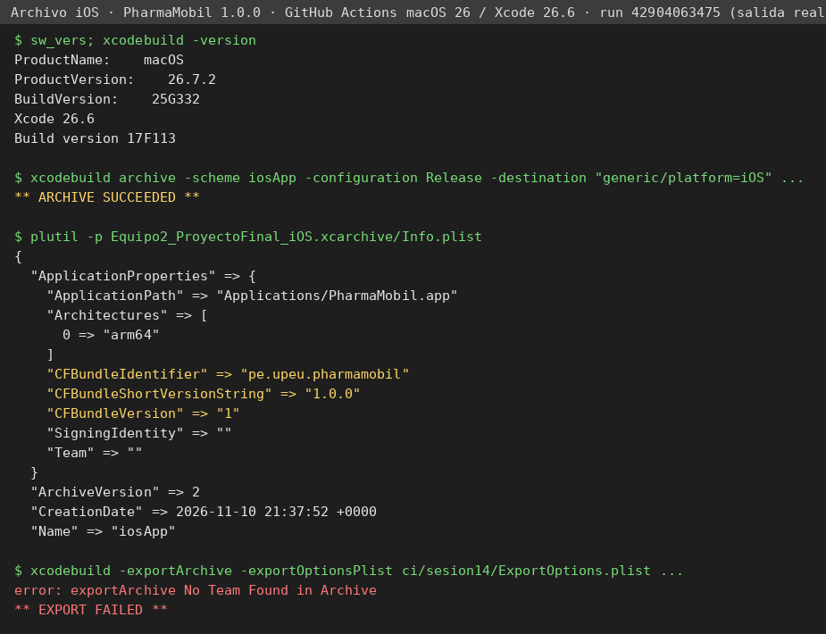

# Sesión 14 · Mejoras finales, firma y builds AAB e IPA

Juan Paredes Cárdenas · código 202311735 · grupo 2 (Equipo 2).
Desarrollo de Aplicaciones Móviles, ciclo VI, semestre 2026-2. Fecha de la sesión: 10 de noviembre de 2026.
Rama `feature/builds-14`, creada desde `develop` después de fusionar `feature/integrador-13` (commit `f3e836f`).
Cada paso de la guía tiene su propio commit.

## Paso 1. Ficha de integración cerrada y alcance congelado

Se revisó la tabla de huecos de la sesión 13 ([docs/sesion13-integrador.md](sesion13-integrador.md)) y se
recorrió el código antes de firmar. Cada fila queda en una sola columna.

| # | Hueco (sesión 13) | Severidad | Decisión final | Qué se hizo / motivo |
|---|---|---|---|---|
| 1 | Fila rechazada (409/400) bloqueaba la cola | Alta | **Cerrado** (S13) | Columnas `intentos` y `ultimoError`; fallos permanentes marcados. |
| 2 | 500/503 tratado igual que 409 | Alta | **Cerrado** (S13) | `ResultadoEnvio` Exito / Transitorio / Permanente. |
| 3 | Reintentos sin límite | Media | **Cerrado** (S13) | 5 intentos con espera 1, 2, 4, 8 y 16 s. |
| 4 | Pantalla solo con «N pendientes» | Alta | **Cerrado** (S13) | Barra de estado con red, fallidas y antigüedad. |
| 5 | Fila fallida sin aviso en segundo plano | Media | **Cerrado** (S13) | Notificación local con permiso de tres estados. |
| 6 | Sin telemetría | Media | **Cerrado** (S13) | Crashlytics detrás de `Telemetria` (activa con `google-services.json` propio). |
| 7 | Al cerrar sesión la base local conserva los datos del usuario anterior | Alta | **Se cierra hoy** → cerrado | `ProductoLocal.limpiar()` borra inventario, cola y fecha de sincronización; `AuthRepositorioRest` lo invoca en `cerrarSesion()`. Prueba `CierreSesionLimpiezaTest`. Rompía el paso 8 del recorrido («equipo limpio para otro usuario»). |
| 7b | Aviso antes de cerrar sesión si quedan pendientes | Media | **Se declara** (L-1) | Requiere un diálogo nuevo en la interfaz (rediseño de pantalla, prohibido tras congelar). Para cerrarla: diálogo de confirmación que muestre `contarPendientes()` y ofrezca «Sincronizar y salir». |
| 8 | Token vencido a mitad de formulario pierde lo escrito | Media | **Se declara** (L-2) | Funcionalidad nueva (borradores persistentes). Para cerrarla: guardar el estado del formulario en `SavedStateHandle`/base local antes de redirigir al login. |
| 9 | Reintento de POST puede duplicar si se pierde la respuesta | Alta | **Se declara** (L-3) | Necesita cambio en PharmaSoft (cabecera `Idempotency-Key`), fuera del alcance del cliente. Mitigado: el 409 por nombre duplicado queda como fallo permanente visible. |
| 10 | 500 en `registrar` relanzaba la excepción | Baja | **Cerrado** (S13) | El producto queda pendiente y se trata como transitorio. |
| 11 | Permisos y telemetría en iOS | Media | **Se declara** (L-4) | `GestorPermisosIos` es stub y `TelemetriaNula` se usa en iOS. Para cerrarla: implementar `UNUserNotificationCenter` y GitLive en `iosMain` con `GoogleService-Info.plist`. |
| 12 | Permiso de cámara para escanear códigos | Baja | **Se descarta** | Nunca estuvo en el alcance comprometido: no existe pantalla de escaneo. Trabajo futuro. |
| 13 | URL del servicio fija en `10.0.2.2` (solo emulador) | Alta | **Se cierra hoy** → cerrado | Hallado hoy. La URL llega del manifiesto (`meta-data pharma.api.url`), que la toma de `-PpharmaApiUrl` o de la variable `PHARMA_API_URL`. Sin valor se usa `10.0.2.2` (emulador). |
| 14 | `usesCleartextTraffic="true"` global, sin configuración de seguridad de red | Media | **Se cierra hoy** → cerrado | Hallado hoy. `res/xml/network_security_config.xml` declara el HTTP de PharmaSoft en la red local. |
| 15 | `versionName = "1.0"` y `applicationId` distinto del pedido para la entrega | Baja | **Se cierra hoy** → cerrado en el paso 3 | `versionName 1.0.0`, `versionCode 1`, `applicationId pe.upeu.pharmamobil`. |

### Alcance congelado (10 de noviembre de 2026)

A partir de este commit no entra funcionalidad nueva: ni funciones fuera del alcance, ni cambios de
arquitectura o de librerías, ni rediseños de pantalla, ni migraciones del esquema. Las dos consultas
nuevas de `Producto.sq` (`borrarTodo`, `borrarMeta`) no cambian el esquema ni requieren migración.
El producto que se entrega es: inicio de sesión JWT con roles, CRUD de productos contra PharmaSoft,
inventario offline-first con cola de envío y sincronización, permiso de notificaciones con tres estados,
cierre de sesión que limpia el equipo y telemetría opcional con Firebase.

## Paso 2. Almacén de claves del equipo

Se creó **un solo** almacén para el Equipo 2, fuera de la carpeta del repositorio, con el comando de la guía
(también en [scripts/crear-almacen-equipo2.sh](../scripts/crear-almacen-equipo2.sh), que se niega a crear el
archivo dentro del repositorio):

```bash
keytool -genkeypair -v \
   -keystore equipo2.jks -storetype JKS \
   -keyalg RSA -keysize 2048 -validity 10000 \
   -alias equipo2
```

| Dato | Valor |
|---|---|
| Archivo | `equipo2.jks` (JKS, fuera del repositorio) |
| Alias | `equipo2` |
| Algoritmo | RSA 2048 bits |
| Titular | `CN=Juan Paredes Cardenas, OU=Equipo 2 - Desarrollo de Aplicaciones Moviles, O=Universidad Peruana Union, L=Lima, ST=Lima, C=PE` |
| Vigencia | 10 000 días: del 10/11/2026 al 28/03/2054 |
| Huella SHA-256 | `00:0D:3C:8A:39:15:29:59:17:3B:23:5C:B3:B6:1A:F1:99:77:CF:96:2B:2A:90:D8:97:85:90:D9:05:83:EF:53` |
| Huella SHA-1 | `85:41:DA:35:99:82:CA:DB:5A:BD:4F:67:8C:03:09:E0:36:0E:CE:9D` |
| Contraseñas | Generadas al azar (24 caracteres). **No se transcriben en ningún archivo del repositorio.** |

**Custodia.** El responsable de la entrega (Juan Paredes) conserva el original. Hay una copia fuera del equipo
de un solo integrante: el archivo y sus contraseñas están guardados en la nube personal del responsable, en una
carpeta privada, y como *Secrets* cifrados del repositorio en GitHub (`KEYSTORE_BASE64`, `KEYSTORE_PASSWORD`,
`KEY_ALIAS`, `KEY_PASSWORD`), que GitHub nunca vuelve a mostrar. Si el almacén se pierde no hay recuperación:
habría que publicar la aplicación con otro identificador.

## Paso 3. Firma configurada sin exponer secretos

1. **`.gitignore`** contiene, antes de cualquier commit con credenciales, las tres líneas de la guía:
   `keystore.properties`, `*.jks` y `*.keystore`. Comprobado con `git check-ignore -v`:
   ```
   .gitignore:26:keystore.properties	keystore.properties
   .gitignore:27:*.jks	x.jks
   .gitignore:28:*.keystore	y.keystore
   ```
2. **`keystore.properties`** (raíz del proyecto, nunca en Git) tiene cuatro claves: `storeFile`, `storePassword`,
   `keyAlias`, `keyPassword`. En el repositorio solo está la plantilla
   [keystore.properties.example](../keystore.properties.example), con asteriscos.
3. **`androidApp/build.gradle.kts`** lee el archivo con `if (f.exists())` y crea `signingConfigs.release` solo si
   hay `storeFile`. Así:
   - quien clona sin el archivo abre y compila el proyecto (`assembleDebug` funciona; la entrega sale sin firmar);
   - con el archivo, `bundleRelease` y `assembleRelease` firman con la clave del equipo.

   Se agregó una guarda respecto del código de la guía: `file(firma.getProperty("storeFile"))` lanza una
   excepción si la propiedad no existe, y el proyecto no abriría para quien no tiene el archivo. La guarda
   `hayFirma` evita ese fallo (criterio 4 de la lista de cotejo).
4. `defaultConfig`: `applicationId = "pe.upeu.pharmamobil"`, `versionCode = 1`, `versionName = "1.0.0"`.
   `buildTypes.release`: firma del equipo, `isMinifyEnabled = true` y `proguard-android-optimize.txt` +
   `proguard-rules.pro`. El `namespace` del código sigue siendo `pe.edu.upeu.pharmamobil` (no cambia paquetes).
5. **En GitHub Actions** el workflow escribe `keystore.properties` en tiempo de ejecución desde los *Secrets*
   del repositorio y lo borra al terminar; el registro de Actions enmascara los valores.

## Paso 4. Paquete de aplicación y instalable firmados, firma verificada

**Cómo se generan.** El workflow [`.github/workflows/sesion14-builds.yml`](../.github/workflows/sesion14-builds.yml)
ejecuta en GitHub Actions (Ubuntu, JDK 21, AGP 9.0.1, build-tools 37.0.0) las dos tareas de la guía:

```bash
./gradlew :androidApp:bundleRelease  -PpharmaApiUrl=https://pharmasoft-equipo2-upeu.azurewebsites.net/api/v1/   # → .aab (entregable E3)
./gradlew :androidApp:assembleRelease -PpharmaApiUrl=https://pharmasoft-equipo2-upeu.azurewebsites.net/api/v1/   # → .apk (pruebas)
```

La URL se toma de [ci/sesion14/pharma-api-url.txt](../ci/sesion14/pharma-api-url.txt). Primero se compiló con la
IPv4 de la PC en el Wi-Fi de la universidad (`http://10.40.28.47:8080/api/v1/`, run `42890970597`); como esa red
(10.40.x.x) no garantiza que el teléfono alcance la PC, PharmaSoft se publicó en Azure App Service
(ver «Servicio en Azure» más abajo) y el APK definitivo apunta a `https://pharmasoft-equipo2-upeu.azurewebsites.net/api/v1/`.

**Quién firma.** Con `keystore.properties` presente (PC del responsable o *Secrets* de GitHub), Gradle firma al
compilar. En esta entrega no se cargaron los *Secrets* en GitHub, así que el workflow publica los dos artefactos
**sin firmar** (rama `evidencias-s14-ci`, carpeta `entrega/sin-firmar`, run `42902994003`, commit `1b69cb5`) junto
con `apksigner.jar` de build-tools 37.0.0, y el responsable los firmó fuera del repositorio con `equipo2.jks`
mediante [scripts/firmar-entrega.sh](../scripts/firmar-entrega.sh): `apksigner sign` para el APK (esquemas v2 y
v3) y `jarsigner` SHA256withRSA para el AAB, que es el mecanismo con que Gradle firma un paquete de aplicación.
Las corridas de CI sin *Secrets* firman con una clave **temporal** (`CN=CLAVE TEMPORAL DE CI`) solo para probar la
compilación; esos archivos no se entregan.

**Verificación con la herramienta oficial** ([evidencias/sesion14/firma](../evidencias/sesion14/firma)):


| Comprobación | Resultado |
|---|---|
| `apksigner verify --print-certs` (APK) | `Verifies`, esquemas v2 y v3 = true, 1 firmante |
| Titular | `CN=Juan Paredes Cardenas, OU=Equipo 2 - Desarrollo de Aplicaciones Moviles, O=Universidad Peruana Union, L=Lima, ST=Lima, C=PE` |
| Huella SHA-256 (ficha de versión) | `00:0D:3C:8A:39:15:29:59:17:3B:23:5C:B3:B6:1A:F1:99:77:CF:96:2B:2A:90:D8:97:85:90:D9:05:83:EF:53` |
| `jarsigner -verify` (AAB) | `jar verified.` con el mismo titular y huella (`keytool -printcert -jarfile`) |
| `bundletool validate` y `build-apks --mode=universal` | El AAB se valida y produce `universal.apk`, que instala y abre en el emulador (`evidencias-ci/emulador/00-universal-desde-aab.png`) |
| Alineación del APK | 0 entradas sin comprimir desalineadas |
| SHA-256 del APK | `39eaa1ad887da014a5650e6894277e72b83673c145222ff181dd6aa3f0387761` |
| SHA-256 del AAB | `7f2fcf6357b1a8a5c74975888c53d29eca56bbb353c4cf6c4ea89347dc3a7150` |

La contraseña no aparece en ningún registro ni documento. Ficha de versión: `applicationId pe.upeu.pharmamobil`,
`versionCode 1`, `versionName 1.0.0` (leídos del APK instalado con `dumpsys package`, ver paso 5).

## Paso 6. Firma y archivo de iOS

**Configuración.** `iosApp/Configuration/Config.xcconfig` declara `PRODUCT_BUNDLE_IDENTIFIER=pe.upeu.pharmamobil`,
`MARKETING_VERSION=1.0.0` y `CURRENT_PROJECT_VERSION=1`, iguales a Android. El proyecto usa firma automática
(`CODE_SIGN_STYLE = Automatic`, `CODE_SIGN_IDENTITY = Apple Development`, `DEVELOPMENT_TEAM = ${TEAM_ID}`).

**Dónde se ejecutó.** El responsable trabaja en Windows y no tiene una Mac ni una cuenta de Apple. Los pasos de Xcode se
ejecutaron en GitHub Actions ([`.github/workflows/sesion14-ios.yml`](../.github/workflows/sesion14-ios.yml)): run
`42904063475`, macOS 26.7.2, Xcode 26.6. Evidencias en [evidencias/sesion14/ios](../evidencias/sesion14/ios) y en la rama
`evidencias-s14-ios`.

| N.º | Paso de la guía | Resultado |
|---|---|---|
| 1 | Equipo de firma en *Signing & Capabilities* | **Límite:** `error: Signing for "iosApp" requires a development team`. No hay cuenta de Apple (ni gratuita ni de pago) que asignar como equipo. |
| 2 | Destino «Any iOS Device» | `-destination 'generic/platform=iOS'`, arquitectura `arm64`. |
| 3 | *Product › Archive* | `** ARCHIVE SUCCEEDED **` (sin firma: `CODE_SIGNING_ALLOWED=NO`). Archivo `Equipo2_ProyectoFinal_iOS.xcarchive`, 72 MB, `CFBundleIdentifier pe.upeu.pharmamobil`, `CFBundleShortVersionString 1.0.0`, `CFBundleVersion 1`, iOS mínimo 18.2. |
| 4 | Distribuir (ad hoc / desarrollo) | **Límite:** `error: exportArchive No Team Found in Archive` · `** EXPORT FAILED **`. |
| 5 | Exportar el `.ipa` | No se genera (depende del paso 4). Se entrega el `.xcarchive` comprimido: `entrega-ios/Equipo2_ProyectoFinal_iOS.xcarchive.zip`. |



Hubo dos intentos previos fallidos por infraestructura, que también quedan registrados: los runners macOS arm64 no
estuvieron disponibles por falta de capacidad, y en `macos-15-intel` (Xcode 16.4) el enlace falló con
`Undefined symbols: _OBJC_CLASS_$_UIViewLayoutRegion`, porque Compose Multiplatform 1.11 usa APIs del SDK de iOS 26.

**Limitación declarada (L-5).** Sin cuenta de Apple no hay certificado, identificador de aplicación ni perfil de
aprovisionamiento. Por eso no hay firma, `.ipa` ni instalación en un iPhone real. Se cumple con el archivo generado
por Xcode y la evidencia del proceso. Para cerrarla: en una Mac con Xcode 26, iniciar sesión con un Apple ID (la
cuenta gratuita basta para un dispositivo propio, con un perfil de 7 días), elegir el equipo en *Signing &
Capabilities*, volver a archivar y distribuir como *Development*. Además, el cliente iOS apunta a
`http://localhost:8080` (`HttpClientFactory.ios.kt`); antes de instalarlo hay que cambiarlo a la URL de Azure.

## Servicio PharmaSoft en Azure (para las pruebas en dispositivos reales)

Un teléfono físico no alcanza `10.0.2.2`, y en la red de la universidad (10.40.x.x) no se puede asegurar que el
teléfono llegue a la PC. Para que las pruebas del paso 7 no dependan de la red local, PharmaSoft se publicó en la
suscripción **Azure for Students** del responsable:

| Dato | Valor |
|---|---|
| URL | `https://pharmasoft-equipo2-upeu.azurewebsites.net` (API en `/api/v1/`, Swagger en `/swagger-ui/index.html`) |
| Servicio | Azure App Service Linux, plan **F1 (Free)**, sin costo; región `chilecentral` (la política de la suscripción solo permite northcentralus, westus, chilecentral, canadacentral y southcentralus) |
| Grupo de recursos | `rg-pharmamobil-s14` · aplicación `pharmasoft-equipo2-upeu` · plan `plan-pharmasoft-f1` |
| Runtime | Java SE 21 (`JAVA:21-java21`) |
| Artefacto | `pharmasoft-azure.jar`, generado por [`.github/workflows/sesion14-backend-azure.yml`](../.github/workflows/sesion14-backend-azure.yml) con [ci/sesion14/preparar_backend_azure.py](../ci/sesion14/preparar_backend_azure.py) (rama `evidencias-s14-backend`) |
| Base de datos | H2 en archivo persistente `/home/data/pharma` (modo Oracle), con las mismas migraciones Flyway que en CI |
| Secretos | La llave JWT se generó con `openssl rand` en Cloud Shell y vive solo como *App Setting* `JWT_SECRET`. El jar no lleva secretos. |
| Comprobación | Desde Cloud Shell: `POST /api/v1/auth/login` (admin) → **HTTP 200** en 2,3 s, token de 403 caracteres; Swagger → HTTP 200. Se creó la categoría 1 «Medicamentos» y 3 productos (HTTP 201). |

Comandos ejecutados en Azure Cloud Shell (10/11/2026):

```bash
az group create -n rg-pharmamobil-s14 -l brazilsouth            # la región luego fue rechazada por la política
az appservice plan create -g rg-pharmamobil-s14 -n plan-pharmasoft-f1 --is-linux --sku F1 -l chilecentral
az webapp create -g rg-pharmamobil-s14 -p plan-pharmasoft-f1 -n pharmasoft-equipo2-upeu --runtime 'JAVA:21-java21'
az webapp config appsettings set -g rg-pharmamobil-s14 -n pharmasoft-equipo2-upeu \
   --settings SPRING_PROFILES_ACTIVE=azure WEBSITES_PORT=8080 PORT=8080 JWT_SECRET="$(openssl rand -base64 64 | tr -d '\n')"
az webapp deploy -g rg-pharmamobil-s14 -n pharmasoft-equipo2-upeu --src-path app.jar --type jar   # Site started successfully
```

Con el plan gratuito la aplicación se detiene cuando nadie la usa, así que la primera petición después de un rato
tarda entre 30 y 60 s. El backend local con MySQL (`backend/pharmaSoft`) sigue siendo la referencia del curso; el
cliente móvil no cambió, solo la URL con la que se compila.

## Paso 5. La minificación no rompió la serialización ni la inyección

**Decisión: la minificación queda ACTIVADA** (`isMinifyEnabled = true`, R8 con `proguard-android-optimize.txt`).
No hizo falta agregar reglas a `proguard-rules.pro`:

- kotlinx.serialization trae sus propias reglas de consumidor y la app usa los serializadores generados
  (`Sesion.serializer()`, DTO con `@Serializable`).
- Koin 4 se declara con el DSL de lambdas (`single { … }`, `viewModelOf(::…)`), sin instanciar clases por nombre.
- Ktor y SQLDelight también traen sus propias reglas.

No se agregaron reglas «a ciegas»: primero se recorrió la versión de entrega completa y luego se buscaron en el registro
los síntomas de la tabla de la guía.

**Cómo se comprobó.** La versión de entrega no es depurable y R8 renombra su código, así que no admite pruebas
instrumentadas. El recorrido se hizo como lo haría una persona, solo con `adb` y el árbol de accesibilidad
([ci/sesion14/recorrido_release.py](../ci/sesion14/recorrido_release.py)), en un emulador Android 14 (API 34) de
GitHub Actions, contra PharmaSoft real (H2) y con el APK de entrega minificado. Run `42913534563`, commit `970016d`
(mismo código de la app que el APK entregado: `git diff 1b69cb5 970016d -- androidApp shared gradle` está vacío).

| Lo que se rompería | Dónde se ejercita | Resultado en la versión minificada |
|---|---|---|
| Serialización de la respuesta de login (`LoginResponseDto`) | Paso 2 | Entra al menú; credencial inválida y sin red con mensajes distintos |
| Deserialización genérica `PaginaResponseDto<ProductoDto>` | Paso 3 (Leer) | La lista se descarga de PharmaSoft |
| Serialización de `ProductoRequestDto` y de `ErrorResponseDto` | Paso 3 (Crear, rechazo 400) | Alta con id 3; el 400 de validación llega al campo Nombre |
| Inyección de `ProductoViewModel`, `SesionViewModel`, `SincronizacionViewModel` | Pasos 2 a 8 | Todas las pantallas abren |
| Perfil de sesión serializado en el almacén cifrado | Paso 5 | La sesión se restaura sin red |
| SQLDelight y cola offline | Pasos 5, 6 y 8 | Alta pendiente, sincronización sin duplicados, limpieza al salir |

Búsqueda en el registro de la app (`logcat`, filtrado por la app, Ktor, Koin, kotlinx.serialization y SQLDelight):
`FATAL EXCEPTION 0 · SerializationException 0 · NoBeanDefFoundException 0 · InstanceCreationException 0 ·
MissingFieldException 0 · ClassNotFoundException 0 · NoSuchMethodException 0`
([logcat-resumen.json](../evidencias/sesion14/emulador/logcat-resumen.json)). También en verde: 86 pruebas de
commonTest/androidHostTest, 0 fallos ([evidencias/sesion14/pruebas](../evidencias/sesion14/pruebas)), incluida la
nueva `CierreSesionLimpiezaTest`.

Las cinco corridas anteriores del recorrido fallaron **por el script, no por la app**, y se corrigieron en commits
`test(sesion14)`: la pantalla de login borra la contraseña después de un error; los gestos de desplazamiento caían
sobre el teclado abierto; las tarjetas quedaban fuera de la pantalla; y «todo enviado» significa 0 pendientes, no
«ya descargó». Ninguna de ellas fue un fallo de R8.

## Paso 7. Pruebas en dispositivos reales y registro de defectos

Matriz completa y registro de defectos: [docs/sesion14-matriz-pruebas.md](sesion14-matriz-pruebas.md).
Guía para instalar y probar (actividad autónoma): [docs/sesion14-guia-instalacion.md](sesion14-guia-instalacion.md).

- **E1, emulador de referencia:** 8/8 pasos recorridos con el APK de entrega minificado; D-01 y D-02 registrados.
- **R1 y R2, teléfonos reales:** el responsable instaló el APK firmado (que apunta a Azure) desde el archivo, sin
  Android Studio. Los resultados se transcriben en la matriz con marca, modelo, versión de Android y capturas.
- **Tercer dispositivo:** queda para la actividad autónoma, como indica la guía.

## Versionado y nomenclatura de la entrega (sección 6 de la guía)

| Dato | Declarado | Leído del archivo |
|---|---|---|
| versionCode | 1 | `versionCode='1'` (`aapt2 dump badging`) · `versionCode=1` (`dumpsys package`) |
| versionName | 1.0.0 | `versionName='1.0.0'` · iOS `CFBundleShortVersionString 1.0.0` |
| applicationId | `pe.upeu.pharmamobil` | `package: name='pe.upeu.pharmamobil'` · iOS `CFBundleIdentifier pe.upeu.pharmamobil` |
| Etiqueta de Git | `v1.0-final` | Sobre `1b69cb5`, el commit del que se compilaron el APK y el AAB entregados |
| Archivos | `Equipo2_ProyectoFinal_Android.aab`, `Equipo2_ProyectoFinal_Android.apk`, `Equipo2_ProyectoFinal_iOS.xcarchive.zip` | Ver SHA-256 en el paso 4 |

Los commits posteriores a `1b69cb5` solo tocan documentación, evidencias y scripts de CI. No cambian
`androidApp/`, `shared/` ni `gradle/` (`git diff 1b69cb5 HEAD -- androidApp shared gradle` vacío), así que la
etiqueta sigue apuntando al código exacto del build entregado.

## Limitaciones declaradas y trabajo futuro

| Id | Limitación | Motivo | Qué haría falta |
|---|---|---|---|
| L-1 | No se avisa antes de cerrar sesión con cambios pendientes; se descartan (D-02) | Diálogo nuevo, fuera del alcance congelado | Diálogo con `contarPendientes()` y opción «Sincronizar y salir» |
| L-2 | Si el token vence a mitad de un formulario, se pierde lo escrito | Funcionalidad nueva | Guardar el borrador antes de redirigir al login |
| L-3 | Un reintento de POST podría duplicar si se pierde la respuesta | Requiere cambiar PharmaSoft | Cabecera `Idempotency-Key` en cliente y servidor |
| L-4 | iOS sin permisos ni telemetría reales | `GestorPermisosIos` stub, `TelemetriaNula` | Implementación en `iosMain` con `UNUserNotificationCenter` y GitLive |
| L-5 | iOS sin firma, sin `.ipa` y sin prueba en iPhone | No hay Mac ni cuenta de Apple | Apple ID en Xcode 26 y distribución *Development*; URL de Azure en `HttpClientFactory.ios.kt` |
| L-6 | Sincronizar al volver la red requiere pulsar «Sincronizar ahora» (D-01) | Observador de conectividad nuevo, fuera del alcance | `NetworkCallback` que dispare `SincronizarUseCase` |
| L-7 | Los *Secrets* de firma no están en GitHub; la firma se hizo fuera del repositorio con `scripts/firmar-entrega.sh` | El responsable no pudo crearlos en la sesión | Cargar `KEYSTORE_BASE64`, `KEYSTORE_PASSWORD`, `KEY_ALIAS` y `KEY_PASSWORD`: el workflow ya los usa |

**Trabajo futuro (descartado del alcance, no pendiente):** escaneo de códigos de barras con cámara (hueco 12) y
base de datos administrada (Azure Database for MySQL) en lugar de H2 en archivo.

## Lista de cotejo

| N.º | Criterio observable | Cumple | Evidencia |
|---|---|---|---|
| 1 | Ficha de integración de la sesión 13 cerrada y alcance congelado por escrito | Sí | Paso 1 |
| 2 | El almacén del equipo existe y hay una copia fuera del equipo de un solo integrante | Sí | Paso 2. Copia entregada al responsable para su nube privada; el original queda fuera del repositorio |
| 3 | Ni el almacén ni sus contraseñas están en el repositorio, y `.gitignore` lo impide | Sí | `git check-ignore`; [sin-secretos-en-git.txt](../evidencias/sesion14/ci/sin-secretos-en-git.txt): «En el historial: ninguno» |
| 4 | El proyecto sigue abriendo y compilando sin el archivo de propiedades | Sí | [compila-sin-propiedades.txt](../evidencias/sesion14/ci/compila-sin-propiedades.txt): `BUILD SUCCESSFUL` |
| 5 | El paquete de aplicación firmado se generó sin errores | Sí | Paso 4: `jarsigner -verify` → `jar verified.`; `bundletool validate` |
| 6 | El instalable de entrega se generó y se instaló en un dispositivo real | Sí | Paso 4 (apksigner) · matriz R1/R2 |
| 7 | La verificación muestra el titular y la huella del certificado del equipo | Sí | [captura-verificacion-firma.png](../evidencias/sesion14/firma/captura-verificacion-firma.png) |
| 8 | La versión de entrega se recorrió completa y la serialización y la inyección funcionan | Sí | Paso 5: 8/8 pasos, registro sin excepciones |
| 9 | Si la minificación quedó desactivada, la decisión está escrita | No aplica | La minificación quedó **activada** |
| 10 | iOS con firma configurada y archivo generado, o su límite documentado | Sí | Paso 6: `ARCHIVE SUCCEEDED` y L-5 |
| 11 | Probado en al menos dos dispositivos reales distintos | Ver matriz | R1 y R2 en [la matriz](sesion14-matriz-pruebas.md) |
| 12 | Cada defecto tiene identificador, pasos, severidad y estado | Sí | D-01, D-02 en la matriz |
| 13 | versionCode, versionName e identificador declarados y coinciden con el archivo | Sí | Sección de versionado |
| 14 | Commits con convención y distribuidos a lo largo de la sesión | Sí | `git log develop..feature/builds-14`: commits `fix/build/ci/test/docs(sesion14)` entre las 14:20 y el cierre |
